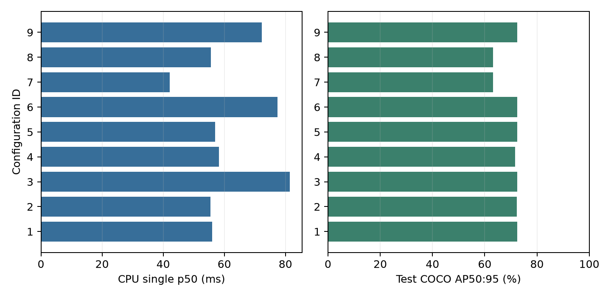
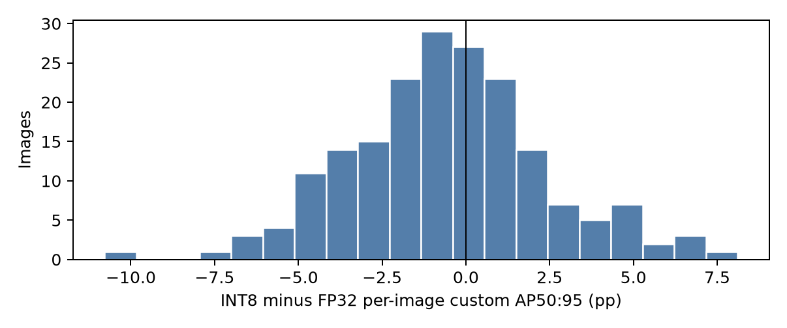
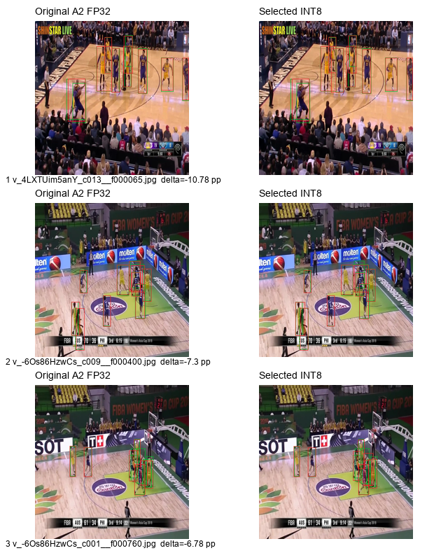

西 安 邮 电 大 学

AI全栈开发实验

题目  算法优化实验

基于实验二模型的CPU推理优化

组号  17

| 学号 | 姓名 | 分工 |
|---|---|---|
| 2610321173 | 高晓琦 |  |
| 2610321160 | 王亿荣 |  |
| 2610321144 | 杨文超 |  |
| 2610321212 | 黄琛聪 |  |
| 2610321071 | 牛翼帆 |  |
| 2610321088 | 刘大勇 |  |

时间  2026年10月26日

一 实验目的

以实验二A2 YOLOv8n已训练权重在CPU上的运行结果为基线，实施3.1.4 CPU推理加速并逐项验证任务目标。通过ONNX导出、ORT计算图优化、OpenVINO部署及INT8量化对照，验证同一CPU上精度、时延、吞吐量、模型体积与内存稳定性的变化，并提供可直接运行的CPU接口。

本实验的主要优化对象是模型执行与部署流程。浮点部署使用同一训练权重，不通过更换硬件计算加速比；量化版本单独分析精度代价。3.1.1量化作为补充的模型压缩实验，噪声测试用于诊断，不作为鲁棒性训练的完成证明。

二 实验环境

| 项目 | 实际配置 |
|---|---|
| CPU | AMD Ryzen 7 5800H with Radeon Graphics |
| 内存 | 系统可识别物理内存约13.86 GiB |
| 系统 / Python | Windows-11-10.0.26200-SP0；Python 3.14.7 |
| 模型加载框架 | PyTorch 2.14.1；torchvision 0.29.1；Ultralytics 8.4.183 |
| CPU部署框架 | ONNX 1.23.2；ONNX Runtime 1.31.0；OpenVINO 2026.4.1 |
| 量化 / 评价 | NNCF 3.4.0；pycocotools COCOeval bbox |
| 执行约束 | 所有推理device=cpu；标准对照4线程、640输入；额外CPU线程/布局/尺寸调优见结果；OpenCV单线程 |

三 实验内容与步骤

3.1 基线模型与数据

原模型来自模型设计与训练.zip中的A2_yolov8n/weights/best.pt，检测类别为player。文件已与压缩包原件逐字节核对。参数量3,138,003，卷积/线性等价运算量约8.64 GFLOPs；推理部署未改变单类别检测任务。

原模型SHA256：2e8624bf93eba97a0adc7f899fbb8e4cd9fd90e42f6546c74f32cc9ba9134776。

| 集合 | 原始图片数 | 本实验用途 |
|---|---|---|
| train | 2158 | INT8校准，使用排序后的前500或1000张 |
| val | 173 | 选择量化配置与精度保持候选 |
| test | 190 | 配置锁定后的最终精度验证；1792个标注框 |

使用原始图片及配套标签，保留实验二的集合身份。本次使用的校准与评测数据不含离线_aug副本，不把不一致的离线增强标签用于评价。历史划分含同源视频跨集合情况，因此结论限于该测试池和本机CPU，不能据此声称跨比赛泛化能力提升。

3.2 比较方法

基线为原A2 PyTorch FP32的CPU推理。部署候选包括FP32 ONNX、FP16 ONNX、训练集校准INT8 ONNX，以及OpenVINO FP32/INT8的LATENCY与THROUGHPUT两种性能提示。所有版本使用同一letterbox规则、RGB归一化、NMS和原图坐标还原；标准对照输入640，尺寸调优配置另行标识。

3.3 CPU推理加速的实现

| 环节 | 具体实现 |
|---|---|
| 模型导出 | eval模式、Conv-BN融合、ONNX opset17；输入空间640x640，batch维动态 |
| ORT图优化 | 只注册CPUExecutionProvider；ORT_ENABLE_ALL；intra_op=4、inter_op=1 |
| OpenVINO执行 | compile_model(device=CPU)，INFERENCE_NUM_THREADS=4，INFERENCE_PRECISION_HINT=f32 |
| 性能提示对照 | LATENCY和THROUGHPUT分别测量；均为同步调用，未模拟异步服务并发 |
| 统一输入与输出 | BGR图像 -> letterbox -> RGB CHW float32/255 -> 推理 -> torchvision NMS -> 原图Nx6坐标 |
| 后处理 | conf=.001、NMS IoU=.55、单类别、max_det=100；用户演示入口默认conf=.25 |
| 执行约束 | Detector固定使用CPU；仅接受pt/onnx/xml格式，CLI与API不自动选择其他设备 |

额外CPU执行调优：对浮点模型比较2、4、8线程；PyTorch分支同时使用Conv-BN融合与channels_last布局。每个配置预热10次、单张计时30次，仅按时延筛选；选定配置再执行完整10/100/20计时、1000次稳定性和全量精度验证。基线与标准对照为4线程，调优版的实际线程数和布局单独记录，不能把收益完全归于计算图格式。另比较576与512输入，只用验证集AP50-95损失不超过1个百分点筛选；保持同一A2权重，将预测坐标正确还原到原图后评价。

3.4 量化方案

静态量化使用ORT QDQ格式，校准卷积的权重和激活。比较逐张量与逐通道权重量化；非卷积算子保持浮点。针对定位敏感计算，保留DFL距离期望、回归输出层或回归分支末两层卷积的浮点精度。AVX2配置采用U8激活、S8权重及reduce_range，INT8权重存储中使用7位数值范围。

OpenVINO INT8采用NNCF MIXED预设和1000张原始训练图校准，并额外比较保留DFL浮点的版本。所有校准文件名与排除节点均写入quantization.json。FP16 ONNX作为浮点存储压缩对照，其CPU执行不保证快于FP32。FP16名称描述导出图精度，执行提供器仍为CPU。

3.5 OpenVINO CPU部署与执行证据

本实验已实际完成OpenVINO模型转换、CPU编译、推理、全量测试集评价和独立进程复测。最终使用OpenVINO FP32、4个CPU线程、LATENCY性能提示，输入640x640。这里的工具完成情况由模型文件、实际调用与验证记录共同证明。

| 证据项 | 实际内容 |
|---|---|
| 工具版本 | OpenVINO 2026.4.1 |
| 部署模型 | models/a2_cpu_tuned/model.xml 与 model.bin |
| 执行设备 | CPU；INFERENCE_NUM_THREADS=4；INFERENCE_PRECISION_HINT=f32 |
| 实际编译调用 | ov.Core().compile_model(model_path, CPU, 配置参数) |
| 统一接口 | scripts/resolution_runtime.py -> cpu_runtime.py -> infer.py；最终模型使用640输入与4线程配置 |
| 正式测速记录 | results/bench_a2_cpu_tuned_LATENCY.json |
| 独立进程复测 | results/repeat_selected.json；配套原CPU基线repeat_baseline.json |
| 检测精度记录 | results/eval_a2_cpu_tuned_test.json；190张图片、1792个标注框 |
| 原生交叉核验 | results/native_a2_cpu_tuned.json；device=cpu，原生model.val已实际运行 |
| 接口与来源检查 | results/verification_cpu.json：原A2文件哈希、动态batch1/4/32、宽高比和预测一致性检查通过 |

model.xml：672113 bytes；SHA256 a5f9194fd9794974c95ef60cca1f114aa12f0ad0e1eb7a08f095d4c5c6195219

model.bin：12530992 bytes；SHA256 0c47c823a9eec5ad4078b147d7cecc207d1b5f5c4fcc1d5ee6f3d0d4ceae76d3

该CPU调优目录与标准OpenVINO FP32 LAT配置使用相同FP32模型和4线程设置，是线程搜索确认后的选定部署及再次测量，不代表重新训练了一个模型。不同计时轮次分别保留，不将微小耗时差异解释为新的模型精度收益。

3.6 验证集上的量化选择

| 验证配置 | AP50 % | AP50-95 % | 文件MB |
|---|---|---|---|
| FP16 ONNX | 98.48 | 78.50 | 6.35 |
| FP32 ONNX | 98.48 | 78.51 | 12.61 |
| E6 AVX2数值范围 | 98.54 | 74.84 | 3.46 |
| E7 DFL浮点 | 98.54 | 76.79 | 3.46 |
| E9 回归末两层浮点 | 98.54 | 76.93 | 3.81 |
| E8 回归输出层浮点 | 98.54 | 76.88 | 3.49 |
| E4 训练1000逐通道 | 97.94 | 72.58 | 3.46 |
| E3 训练1000逐张量 | 97.77 | 72.05 | 3.39 |
| E2 训练500逐张量 | 97.70 | 72.16 | 3.39 |
| E1 验证173逐张量 | 97.90 | 72.82 | 3.39 |
| OV FP32 | 98.48 | 78.51 | 13.20 |
| OV INT8+DFL浮点 | 98.20 | 67.73 | 4.32 |
| OV INT8 | 98.10 | 66.47 | 4.32 |
| CPU执行调优版 | 98.48 | 78.51 | 13.20 |

E1使用验证图校准，仅作诊断；最终INT8配置选择限定于训练集校准候选。验证集最高AP50-95的ORT INT8候选为E9，其验证集AP50-95损失为1.58个百分点，未满足1个百分点的精度保持门槛。因此不将其直接选为默认部署。

默认CPU部署的规则为：先按验证集AP50-95损失不超过1个百分点筛选，再在单张p50距离最快配置不超过5%的候选中，优先选择batch32吞吐最高者。该规则避免为约1毫秒的单张差异放弃明显的批量吞吐收益。测试标签不参与校准、层选择或精度门槛筛选。量化模型保留用于展示体积与定位误差的取舍。

3.7 统一验证与计时协议

| 项目 | 统一设置 |
|---|---|
| 精度 | pycocotools COCOeval bbox：mAP50、mAP50-95、AP-S/M/L；IoU .50:.05:.95，maxDets=100 |
| 单张测速 | 预热10次，计时100次；报告p50/p95 |
| batch32测速 | 预热10次，计时20次；报告平均批延迟及32/平均秒数 |
| 计时范围 | 内存JPEG解码、letterbox、RGB归一化、CPU推理、共享NMS和原图坐标还原 |
| 排除范围 | 磁盘读写、模型加载、冷启动、视频/Web链路开销 |
| 内存 | 进程RSS每10次采样取峰值；单位MB=10^6 bytes |
| 连续运行 | 每配置1000次单张循环，每100次记录RSS；波动=(max-min)/mean，阈值5% |
| 测量安排 | 单个配置顺序运行，校准与导出不并行占用CPU |
| 噪声诊断 | 归一化输入加sigma=.02高斯扰动，按文件名固定随机种子，裁剪到[0,1] |

四 实验关键技术与难点

重点在于保持各后端预处理及NMS一致，避免将评价器差异误写为精度提升；校准集合与测试集合分离，避免依测试结果选择量化层；区分文件存储压缩、参数量、实际运行内存和算子执行速度；对定位敏感层保留浮点表示，并核对最终接口与已保存预测的一致性。

五 实验结果与分析

5.1 CPU加速主结果

| 配置 | p50 ms | p95 ms | B32均值ms | B32 FPS |
|---|---|---|---|---|
| OpenVINO FP32 4 threads | 56.07 | 60.59 | 1785.65 | 17.92 |
| ORT FP16 | 55.47 | 64.27 | 2112.45 | 15.15 |
| ORT FP32 | 81.42 | 96.67 | 2290.64 | 13.97 |
| ORT INT8 mixed | 58.26 | 64.83 | 2430.73 | 13.16 |
| OpenVINO FP32 LAT | 57.05 | 67.70 | 1799.28 | 17.78 |
| OpenVINO FP32 THR | 77.45 | 84.65 | 2452.37 | 13.05 |
| OpenVINO INT8 LAT | 42.18 | 46.97 | 1717.43 | 18.63 |
| OpenVINO INT8 THR | 55.63 | 60.85 | 2036.73 | 15.71 |
| A2 PyTorch FP32 | 72.22 | 82.37 | 3562.59 | 8.98 |

最终CPU推荐为OpenVINO FP32 4 threads。相对实验二原A2 CPU PyTorch，单张中位延迟由72.22 ms降至56.07 ms，下降22.36%；batch32平均批延迟下降49.88%，吞吐量由8.98 FPS提高至17.92 FPS，提高99.51%。

这些数值均在同一CPU上、按相同计时范围得到；标准对照使用4线程，额外调优版使用4线程，保持浮点模型结构。THR为性能提示，不等同于异步多请求服务吞吐；FPS是batch32吞吐率，不能直接视为带视频读取、跟踪或Web服务的整链路帧率。

独立进程第二轮复测：原CPU基线单张p50 69.83 ms，推荐方案50.40 ms；本轮单张下降27.82%；B32延迟下降47.76%，B32吞吐提高91.42%。第二轮只复测主对照的10/100/20计时；1000次稳定性记录来自主测试。两轮原始数据分别保存，主表不择优替换。

5.2 精度、定位与模型体积

| 配置 | AP50 % | AP50-95 % | AP-S % | AP-M % | AP-L % | 文件MB |
|---|---|---|---|---|---|---|
| OpenVINO FP32 4 threads | 97.95 | 72.39 | 40.00 | 71.96 | 78.73 | 13.20 |
| ORT FP16 | 97.95 | 72.28 | 40.00 | 71.96 | 78.75 | 6.35 |
| ORT FP32 | 97.95 | 72.39 | 40.00 | 71.96 | 78.73 | 12.61 |
| ORT INT8 mixed | 97.51 | 71.60 | 40.00 | 71.43 | 76.97 | 3.81 |
| OpenVINO FP32 LAT | 97.95 | 72.39 | 40.00 | 71.96 | 78.73 | 13.20 |
| OpenVINO FP32 THR | 97.95 | 72.39 | 40.00 | 71.96 | 78.73 | 13.20 |
| OpenVINO INT8 LAT | 97.50 | 63.16 | 20.00 | 62.58 | 72.10 | 4.32 |
| OpenVINO INT8 THR | 97.50 | 63.16 | 20.00 | 62.58 | 72.10 | 4.32 |
| A2 PyTorch FP32 | 97.95 | 72.39 | 40.00 | 71.96 | 78.73 | 6.51 |

推荐部署相对基线的测试AP50-95变化为0.00个百分点。浮点CPU加速的主要收益是执行效率，不能将微小浮点数值差异解释为新的训练精度提升。

测试集面积分组：小于32²的目标1个，32²至96²之间1688个，大于等于96²的目标103个。AP-S仅对应1个小目标，统计很不稳定，不据此概括小目标泛化表现。COCOeval保留面积ignore规则，没有简单过滤其他尺寸GT后将其预测当成误检。

各部署版本源网络均为3.138M参数；640输入约8.64等价GFLOPs，576/512输入的卷积等价运算量按尺寸平方比例下降。量化改变数值表示与执行内核，未通过剪枝减少主体网络参数。FP32 ONNX、原PT和OpenVINO IR的文件格式不同，应分别比较文件体积；不能用文件缩减比例替代内存降幅。

5.3 速度与精度的关联

尺寸调优验证记录：576输入的AP50-95损失1.24pp、初筛p50 43.94 ms；512输入的AP50-95损失2.11pp、初筛p50 38.62 ms。该初筛计时不替代主表正式测速。

| 编号 | CPU配置 |
|---|---|
| 1 | OpenVINO FP32 4 threads |
| 2 | ORT FP16 |
| 3 | ORT FP32 |
| 4 | ORT INT8 mixed |
| 5 | OpenVINO FP32 LAT |
| 6 | OpenVINO FP32 THR |
| 7 | OpenVINO INT8 LAT |
| 8 | OpenVINO INT8 THR |
| 9 | A2 PyTorch FP32 |

图1  全部候选使用相同CPU和评价口径。量化是否有效须分别回答：文件是否更小、推理是否更快、定位质量是否保持。若INT8在本机反而更慢，或AP50-95损失超过门槛，则不将其作为默认CPU方案。

5.4 原生评价器独立复核

| 模型 | P % | R % | mAP50 % | mAP50-95 % |
|---|---|---|---|---|
| a2_original | 98.66 | 95.76 | 98.43 | 72.58 |
| a2_cpu_tuned | 98.65 | 95.76 | 98.43 | 72.58 |

原生model.val固定device=cpu、test190、batch4；标准模型imgsz640，尺寸调优模型按选定输入尺寸验证、conf=.001、IoU=.55、rect=False、workers0。其P/R为原生工作点指标，不是固定conf=.25的计数。主表采用COCOeval，本页指标单独列出，不跨评价器计算增益。

与实验二的比较口径

报告使用实验二A2原权重的CPU复测作为优化前基线，数据身份、硬件、预处理规则、NMS及计时范围保持一致；尺寸调优版本明确记录输入尺寸变化，不能把其收益完全归于后端。实验二原报告中的验证摘要0.418来自不同集合和评价口径，不能直接减去本次原始test的AP值来证明优化效果。

5.5 噪声诊断

| 配置 | 干净AP50 % | 噪声AP50 % | 下降pp |
|---|---|---|---|
| ORT FP32 | 97.95 | 97.63 | 0.33 |
| ORT INT8 mixed | 97.51 | 97.60 | -0.09 |
| OpenVINO INT8 LAT | 97.50 | 97.56 | -0.05 |

噪声仅作压缩可靠性诊断，未进行鲁棒性训练，不能据此列为3.1.6方向已完成。

5.6 量化误差分布

图2  已锁定INT8减FP32的逐帧自定义AP50-95差值。该指标用于定位误差集中帧，不能将逐帧均值替代全局COCO AP。以下样例按差值从低到高固定选择前三帧，不根据测试样例继续调整模型。

5.7 内存与连续运行

| CPU配置 | RSS峰值MB | 1000次RSS波动 % | 不超过5% |
|---|---|---|---|
| OpenVINO FP32 4 threads | 1979.67 | 0.06 | 通过 |
| ORT FP16 | 1734.51 | 0.02 | 通过 |
| ORT FP32 | 1745.03 | 0.04 | 通过 |
| ORT INT8 mixed | 2489.23 | 0.51 | 通过 |
| OpenVINO FP32 LAT | 1920.24 | 0.03 | 通过 |
| OpenVINO FP32 THR | 2904.59 | 0.02 | 通过 |
| OpenVINO INT8 LAT | 1724.95 | 0.01 | 通过 |
| OpenVINO INT8 THR | 2536.43 | 0.02 | 通过 |
| A2 PyTorch FP32 | 1307.66 | 2.73 | 通过 |

RSS为整个Python进程内存，包含框架与模型运行开销。1000次检查反映该窗口内的增长情况，不能证明所有输入和运行时长均无内存泄漏。

推荐CPU方案的进程RSS峰值由基线1307.66 MB变为1979.67 MB，增加51.39%。因此本实验可以证明CPU批量推理提速与本轮连续运行稳定，但不能声称实现了内存占用降低30%的目标。

5.8 量化误差样例

图3  左侧FP32、右侧INT8；绿框为GT，红框为conf>=.25的预测；相同图片保持原比例。图示用于解释定位误差，不代替完整测试集指标。

5.9 任务书要求对照

| 要求 | 本次CPU证据 | 判断 |
|---|---|---|
| 以实验二模型为起点 | A2原件SHA256核验、单类别与参数量核验 | 完成 |
| CPU优化方向 | 3.1.4推理加速：完成部署、测速与精度验证；全部性能目标未同时达到 | 实施完成；目标部分达成 |
| OpenVINO工具执行 | FP32 IR模型、CPU编译、190图评价与独立复测，证据见3.5 | 已完成 |
| 单张延迟降低40% | 主测下降22.36%；复测下降27.82% | 未达标 |
| B32延迟降低40% | 主测下降49.88%；复测下降47.76% | 两轮均达标 |
| B32吞吐提高50% | 主测提高99.51%；复测提高91.42% | 两轮均达标 |
| 精度变化不超过1pp | 两种AP指标最大变化0.00pp | 达标 |
| 量化实验3.1.1 | 校准矩阵、混合精度、原生与COCO对照 | 完成实验；部分候选不满足保持门槛 |
| 稳定性检查 | 9配置各1000次，逐点RSS归档 | 见5.7逐项结果 |
| 统一CPU接口 | pt/onnx/xml、动态batch1/4/32、不同宽高比坐标检查 | 通过 |
| 其他方向 | 未在本次CPU方案中开展剪枝、蒸馏或鲁棒性训练 | 不列为完成 |

3.1.4的联合判据结论为：未同时达到所列全部门槛，按表中实测分别判断。本报告仅用CPU同设备对照判断，不使用不同硬件之间的速度差证明优化。

六 实验总结与展望

本实验实施的主要方向是实验二A2模型的CPU推理加速，达标情况按5.9的实测逐项判断。采用OpenVINO FP32 4 threads作为本机默认部署，保留原模型、浮点ONNX、量化ONNX与OpenVINO产物及完整对照结果。推荐依据是验证精度门槛、单张延迟容差和本机批量吞吐，不预设INT8或某一后端一定更优。

推荐CPU方案单张p50为56.07 ms，测试mAP50-95为72.39%；相对原CPU基线，单张延迟下降22.36%，batch32吞吐提高99.51%。量化的体积、速度与定位代价单独保留，便于按部署约束选择。

OpenVINO CPU部署已经完成。两轮测试均证明批量延迟、吞吐与精度保持达到所列目标；单张延迟降幅未达到40%，因此不将任务3.1.4的全部指标写成全部达标。

结论限于当前CPU、640输入及历史数据划分。后续优先补充独立比赛视频与更稳定的小目标测试样本，并测量视频解码、跟踪和服务接口组成的完整CPU链路；若目标CPU型号改变，应在该CPU上重跑当前脚本验证。

复现与交付

代码、模型、原始train/val/test图片标签、逐配置结果、预测归档、报告与可编辑正文统一位于优化目录。scripts/resolution_runtime.py为CPU接口，run_cpu.py为命令入口，bench_exp3.py为统一测速，eval_detail.py为COCO与分层/噪声评价，native_val.py为原生评价，export_fp32.py/export_fp16.py/export_quant.py为导出量化入口。README.md提供命令，运行CPU推理.ps1自动选择测试图片。

七 参考文献

[1] 实验3任务书、程序优化实验指导 第三课、EXP3_IMPL_2P实施文档、实验二原报告与模型产物。

[2] ONNX Runtime. Quantize ONNX models. https://onnxruntime.ai/docs/performance/model-optimizations/quantization.html

[3] OpenVINO / NNCF. Quantization API. https://openvinotoolkit.github.io/nncf/autoapi/nncf/

[4] Ultralytics. Detection validation. https://docs.ultralytics.com/modes/val/
