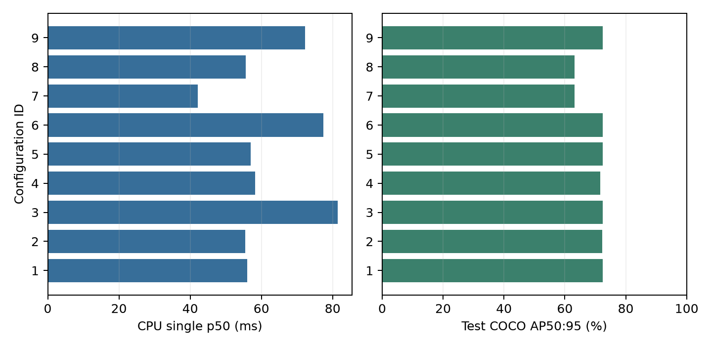
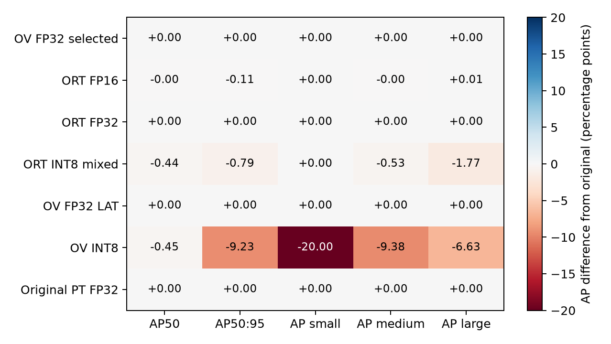
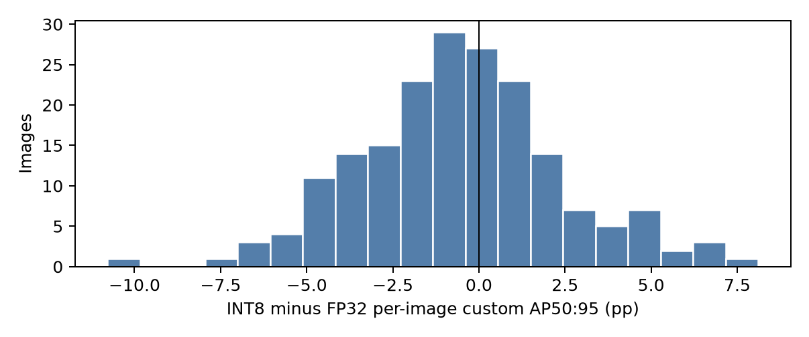
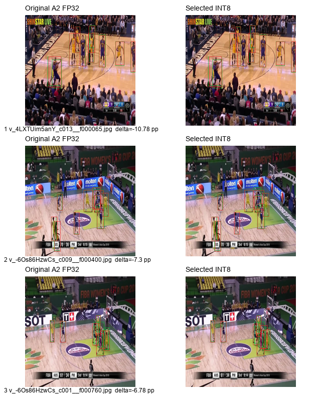
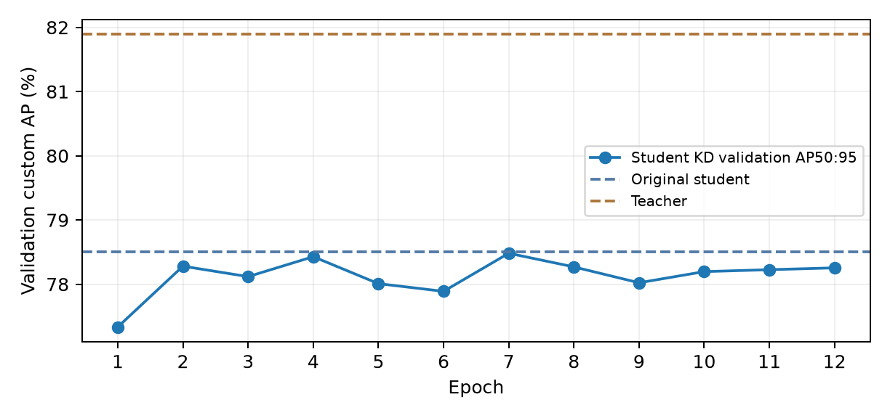
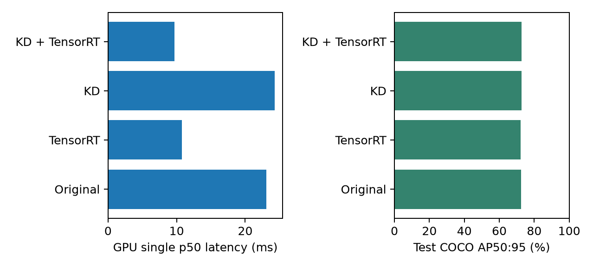
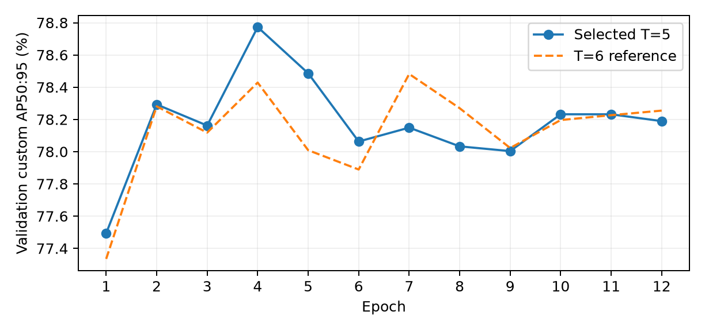

西 安 邮 电 大 学

AI全栈开发实验

题目  算法优化实验

实验二模型的量化、蒸馏与推理优化

组号  17

| 学号 | 姓名 | 分工 |
|---|---|---|
| 2610321173 | 高晓琦 |  |
| 2610321160 | 王亿荣 |  |
| 2610321144 | 杨文超 |  |
| 2610321212 | 黄琛聪 |  |
| 2610321071 | 牛翼帆 |  |
| 2610321088 | 刘大勇 |  |

时间  2026年10月27日

一 实验目的

以实验二A2 YOLOv8n已训练权重为未优化基线，按实验3任务书实施推理加速，并完成EXP3_IMPL_2P.md的量化、蒸馏、误差诊断及部署实验。分别比较CPU到GPU的硬件加速、同一GPU上TensorRT的后端优化，以及蒸馏训练前后的模型精度，避免混淆不同来源的收益。

主优化方向为3.1.4推理加速，并实施3.1.1量化和3.1.3知识蒸馏。CPU方案使用ORT/OpenVINO，GPU方案实际使用TensorRT；噪声测试作为文档要求的可靠性诊断，不等同于PGD鲁棒性训练。结果限定于本机CPU和RTX 3050，未声称在Kaggle T4实测。

二 实验环境

| 项目 | 实际配置 |
|---|---|
| CPU | AMD Ryzen 7 5800H with Radeon Graphics |
| 内存 | 系统可识别物理内存约13.86 GiB |
| 系统 / Python | Windows-11-10.0.26200-SP0；Python 3.14.7 |
| 模型加载框架 | PyTorch 2.14.1；torchvision 0.29.1；Ultralytics 8.4.183 |
| CPU部署框架 | ONNX 1.23.2；ONNX Runtime 1.31.0；OpenVINO 2026.4.1 |
| 量化 / 评价 | NNCF 3.4.0；pycocotools COCOeval bbox |
| GPU / TensorRT | NVIDIA GeForce RTX 3050 Laptop GPU；显存约4.00 GiB；TensorRT 11.4.0.106；CUDA 13.2 |
| 执行约束 | CPU与GPU分别明确记录；标准CPU对照4线程，640输入；OpenCV单线程；测速不与训练并行 |

本次使用命令行虚拟环境Python 3.14.7；任务书参考环境为Python 3.12，二者并非完全相同。各实际框架/加速库版本如表所列，所有实验均在所列实际环境运行验证。CPU与GPU结果只在对应设备内按相同协议计算优化比。

三 实验内容与步骤

3.1 基线模型与数据

原模型来自模型设计与训练.zip中的A2_yolov8n/weights/best.pt，检测类别为player。文件已与压缩包原件逐字节核对。参数量3,138,003，卷积/线性等价运算量约8.64 GFLOPs；推理部署未改变单类别检测任务。

原模型SHA256：2e8624bf93eba97a0adc7f899fbb8e4cd9fd90e42f6546c74f32cc9ba9134776。

教师来自同一压缩包A2_yolov8m/weights/best.pt，参数25,856,899；SHA256：9b0c83ac25c9a8e893dda125327a2f2021a8f075924534846b19039668fa4931。来源校验见gpu/results/verification_md.json。

| 集合 | 原始图片数 | 本实验用途 |
|---|---|---|
| train | 2158 | 蒸馏训练；INT8校准使用前500或1000张 |
| val | 173 | 选择量化配置与精度保持候选 |
| test | 190 | 配置锁定后的最终精度验证；1792个标注框 |

使用原始图片及配套标签，保留实验二的集合身份。本次使用的校准与评测数据不含离线_aug副本，不把不一致的离线增强标签用于评价。历史划分含同源视频跨集合情况，因此结论限于该测试池和本机CPU/GPU，不能据此声称跨比赛泛化能力提升。

3.2 比较方法

基线为原A2 PyTorch FP32的CPU推理。部署候选包括FP32 ONNX、FP16 ONNX、训练集校准INT8 ONNX，以及OpenVINO FP32/INT8的LATENCY与THROUGHPUT两种性能提示。所有版本使用同一letterbox规则、RGB归一化、NMS和原图坐标还原；标准对照输入640，尺寸调优配置另行标识。

3.3 CPU推理加速的实现

| 环节 | 具体实现 |
|---|---|
| 模型导出 | eval模式、Conv-BN融合、ONNX opset17；输入空间640x640，batch维动态 |
| ORT图优化 | 只注册CPUExecutionProvider；ORT_ENABLE_ALL；intra_op=4、inter_op=1 |
| OpenVINO执行 | compile_model(device=CPU)，INFERENCE_NUM_THREADS=4，INFERENCE_PRECISION_HINT=f32 |
| 性能提示对照 | LATENCY和THROUGHPUT分别测量；均为同步调用，未模拟异步服务并发 |
| 统一输入与输出 | BGR图像 -> letterbox -> RGB CHW float32/255 -> 推理 -> torchvision NMS -> 原图Nx6坐标 |
| 后处理 | conf=.001、NMS IoU=.55、单类别、max_det=100；用户演示入口默认conf=.25 |
| 执行约束 | Detector固定使用CPU；仅接受pt/onnx/xml格式，CLI与API不自动选择其他设备 |

额外CPU执行调优：对浮点模型比较2、4、8线程；PyTorch分支同时使用Conv-BN融合与channels_last布局。每个配置预热10次、单张计时30次，仅按时延筛选；选定配置再执行完整10/100/20计时、1000次稳定性和全量精度验证。基线与标准对照为4线程，调优版的实际线程数和布局单独记录，不能把收益完全归于计算图格式。另比较576与512输入，只用验证集AP50-95损失不超过1个百分点筛选；保持同一A2权重，将预测坐标正确还原到原图后评价。

3.4 量化方案

静态量化使用ORT QDQ格式，校准卷积的权重和激活。比较逐张量与逐通道权重量化；非卷积算子保持浮点。针对定位敏感计算，保留DFL距离期望、回归输出层或回归分支末两层卷积的浮点精度。AVX2配置采用U8激活、S8权重及reduce_range，INT8权重存储中使用7位数值范围。

OpenVINO INT8采用NNCF MIXED预设和1000张原始训练图校准，并额外比较保留DFL浮点的版本。所有校准文件名与排除节点均写入quantization.json。FP16 ONNX作为浮点存储压缩对照，其CPU执行不保证快于FP32。FP16名称描述导出图精度，执行提供器仍为CPU。

3.5 OpenVINO CPU部署与执行证据

本实验已实际完成OpenVINO模型转换、CPU编译、推理、全量测试集评价和独立进程复测。最终使用OpenVINO FP32、4个CPU线程、LATENCY性能提示，输入640x640。这里的工具完成情况由模型文件、实际调用与验证记录共同证明。

| 证据项 | 实际内容 |
|---|---|
| 工具版本 | OpenVINO 2026.4.1 |
| 部署模型 | models/a2_cpu_tuned/model.xml 与 model.bin |
| 执行设备 | CPU；INFERENCE_NUM_THREADS=4；INFERENCE_PRECISION_HINT=f32 |
| 实际编译调用 | ov.Core().compile_model(model_path, CPU, 配置参数) |
| 统一接口 | scripts/resolution_runtime.py -> cpu_runtime.py -> infer.py；最终模型使用640输入与4线程配置 |
| 正式测速记录 | results/bench_a2_cpu_tuned_LATENCY.json |
| 独立进程复测 | results/repeat_selected.json；配套原CPU基线repeat_baseline.json |
| 检测精度记录 | results/eval_a2_cpu_tuned_test.json；190张图片、1792个标注框 |
| 原生交叉核验 | results/native_a2_cpu_tuned.json；device=cpu，原生model.val已实际运行 |
| 接口与来源检查 | results/verification_cpu.json：原A2文件哈希、动态batch1/4/32、宽高比和预测一致性检查通过 |

model.xml：672113 bytes；SHA256 a5f9194fd9794974c95ef60cca1f114aa12f0ad0e1eb7a08f095d4c5c6195219

model.bin：12530992 bytes；SHA256 0c47c823a9eec5ad4078b147d7cecc207d1b5f5c4fcc1d5ee6f3d0d4ceae76d3

该CPU调优目录与标准OpenVINO FP32 LAT配置使用相同FP32模型和4线程设置，是线程搜索确认后的选定部署及再次测量，不代表重新训练了一个模型。不同计时轮次分别保留，不将微小耗时差异解释为新的模型精度收益。

3.6 验证集上的量化选择

| 验证配置 | AP50 % | AP50-95 % | 文件MB |
|---|---|---|---|
| FP16 ONNX | 98.48 | 78.50 | 6.35 |
| FP32 ONNX | 98.48 | 78.51 | 12.61 |
| E6 AVX2数值范围 | 98.54 | 74.84 | 3.46 |
| E7 DFL浮点 | 98.54 | 76.79 | 3.46 |
| E9 回归末两层浮点 | 98.54 | 76.93 | 3.81 |
| E8 回归输出层浮点 | 98.54 | 76.88 | 3.49 |
| E4 训练1000逐通道 | 97.94 | 72.58 | 3.46 |
| E3 训练1000逐张量 | 97.77 | 72.05 | 3.39 |
| E2 训练500逐张量 | 97.70 | 72.16 | 3.39 |
| E1 验证173逐张量 | 97.90 | 72.82 | 3.39 |
| OV FP32 | 98.48 | 78.51 | 13.20 |
| OV INT8+DFL浮点 | 98.20 | 67.73 | 4.32 |
| OV INT8 | 98.10 | 66.47 | 4.32 |
| CPU执行调优版 | 98.48 | 78.51 | 13.20 |

E1使用验证图校准，仅作诊断；最终INT8配置选择限定于训练集校准候选。验证集最高AP50-95的ORT INT8候选为E9，其验证集AP50-95损失为1.58个百分点，未满足1个百分点的精度保持门槛。因此不将其直接选为默认部署。

默认CPU部署的规则为：先按验证集AP50-95损失不超过1个百分点筛选，再在单张p50距离最快配置不超过5%的候选中，优先选择batch32吞吐最高者。该规则避免为约1毫秒的单张差异放弃明显的批量吞吐收益。测试标签不参与校准、层选择或精度门槛筛选。量化模型保留用于展示体积与定位误差的取舍。

3.6.1 量化矩阵的完整测试与测速

| 量化配置 | 测试AP50 % | 测试AP95 % | p50 ms | B32 FPS |
|---|---|---|---|---|
| E1 val173 PT | 97.92 | 69.31 | 73.00 | 10.57 |
| E2 train500 PT | 97.19 | 68.69 | 74.56 | 10.41 |
| E3 train1000 PT | 97.61 | 68.98 | 70.53 | 10.25 |
| E4 train1000 PC | 97.36 | 68.33 | 69.29 | 10.28 |

上述四个量化产物均保留了实际测试、原生验证和各1000次稳定性记录。此表采用校准矩阵阶段已经保存的CPU测量，逐字节核验模型后归档在results/calibration_benchmarks；与本轮GPU计时分别报告，不跨轮择优计算加速比。

最终锁定混合精度INT8文件相对FP32 ONNX缩小69.80%，相对原PT文件缩小41.47%。原PT以检查点格式存储，推理转为FP32；不能把不同存储格式的文件缩减率当成参数量或实际运行内存的缩减率。量化实验的实际压缩率单独列出，不将任务书中的75%示例直接当作实测结果。

3.7 统一验证与计时协议

| 项目 | 统一设置 |
|---|---|
| 精度 | pycocotools COCOeval bbox：mAP50、mAP50-95、AP-S/M/L；IoU .50:.05:.95，maxDets=100 |
| 单张测速 | 预热10次，计时100次；报告p50/p95 |
| batch32测速 | 预热10次，计时20次；报告平均批延迟及32/平均秒数 |
| 计时范围 | 内存JPEG解码、letterbox、RGB归一化、输入传输、模型推理、共享NMS、结果回CPU与坐标还原 |
| 排除范围 | 磁盘读写、模型加载、冷启动、视频/Web链路开销 |
| 内存 | 进程RSS每10次采样取峰值；单位MB=10^6 bytes |
| 连续运行 | 每配置1000次单张循环，每100次记录RSS；波动=(max-min)/mean，阈值5% |
| 测量安排 | 训练后逐配置顺序测速；GPU在计时前后CUDA同步；每个正式配置1000次稳定性检查 |
| 噪声诊断 | 归一化输入加sigma=.02高斯扰动，按文件名固定随机种子，裁剪到[0,1] |

任务书阶段1明确为六个任务至少选择一个，阶段2为选做。本实验选择3.1.4作为完整验收主方向，其他实验按实际执行和实测结果列出。实验二为单类别目标检测模型，保留YOLOv8n及其数据；精度一致性使用AP50与AP50-95的百分点差，不把分类Top-1名称套用到检测任务。

3.8 GPU优化与知识蒸馏的实现

GPU主路径为原A2 -> 融合Conv-BN的FP16 ONNX -> TensorRT引擎。输入空间640x640，动态batch profile为1/8/32，workspace为512 MiB；TensorRT按图完成部署优化。独立CUDA流与当前Torch流建立依赖，计时前后同步。

| 环节 | 实现 |
|---|---|
| 预处理 | 单张直接解码；批量使用4个CPU工作线程解码和letterbox，保持原图比例 |
| 数据传输 | CHW uint8传到GPU，在GPU转float32并除255，减少浮点输入传输量 |
| 缓存复用 | 按batch形状复用CUDA uint8、浮点输入和输出缓冲区 |
| 模型推理 | 调用真实TensorRT execute_async_v3；后处理沿用共享NMS及原图坐标还原 |
| 蒸馏损失 | 0.3检测 + 0.5三尺度特征MSE + 0.2前景Bernoulli KL |
| 蒸馏训练 | 教师冻结，学生及训练适配层更新；AdamW，lr=.002/5=.0004，12轮，有效batch16 |
| 温度比较 | T6完整基准；T5/8/10等预算首轮筛选，选定温度从断点续训至12轮 |
| 模型选择 | 校准和温度/轮次选择只使用train与val；test只作锁定后的验证 |

CPU/GPU硬件迁移与同GPU推理流程优化分别比较；统一接口保留原图Nx6输出，检测类别始终为player。实际动态batch1/4/32与不同宽高比坐标检查均有归档。

四 实验关键技术与难点

重点在于保持各后端预处理及NMS一致，避免将评价器差异误写为精度提升；校准集合与测试集合分离，避免依测试结果选择量化层；区分文件存储压缩、参数量、实际运行内存和算子执行速度；对定位敏感层保留浮点表示，并核对最终接口与已保存预测的一致性。

五 实验结果与分析

5.1 CPU同设备对照

| 配置 | p50 ms | p95 ms | B32均值ms | B32 FPS |
|---|---|---|---|---|
| OpenVINO FP32 4 threads | 56.07 | 60.59 | 1785.65 | 17.92 |
| ORT FP16 | 55.47 | 64.27 | 2112.45 | 15.15 |
| ORT FP32 | 81.42 | 96.67 | 2290.64 | 13.97 |
| ORT INT8 mixed | 58.26 | 64.83 | 2430.73 | 13.16 |
| OpenVINO FP32 LAT | 57.05 | 67.70 | 1799.28 | 17.78 |
| OpenVINO FP32 THR | 77.45 | 84.65 | 2452.37 | 13.05 |
| OpenVINO INT8 LAT | 42.18 | 46.97 | 1717.43 | 18.63 |
| OpenVINO INT8 THR | 55.63 | 60.85 | 2036.73 | 15.71 |
| A2 PyTorch FP32 | 72.22 | 82.37 | 3562.59 | 8.98 |

最终CPU推荐为OpenVINO FP32 4 threads。相对实验二原A2 CPU PyTorch，单张中位延迟由72.22 ms降至56.07 ms，下降22.36%；batch32平均批延迟下降49.88%，吞吐量由8.98 FPS提高至17.92 FPS，提高99.51%。

这些数值均在同一CPU上、按相同计时范围得到；标准对照使用4线程，额外调优版使用4线程，保持浮点模型结构。THR为性能提示，不等同于异步多请求服务吞吐；FPS是batch32吞吐率，不能直接视为带视频读取、跟踪或Web服务的整链路帧率。

独立进程第二轮复测：原CPU基线单张p50 69.83 ms，推荐方案50.40 ms；本轮单张下降27.82%；B32延迟下降47.76%，B32吞吐提高91.42%。第二轮只复测主对照的10/100/20计时；1000次稳定性记录来自主测试。两轮原始数据分别保存，主表不择优替换。

5.2 精度、定位与模型体积

| 配置 | AP50 % | AP50-95 % | AP-S % | AP-M % | AP-L % | 文件MB |
|---|---|---|---|---|---|---|
| OpenVINO FP32 4 threads | 97.95 | 72.39 | 40.00 | 71.96 | 78.73 | 13.20 |
| ORT FP16 | 97.95 | 72.28 | 40.00 | 71.96 | 78.75 | 6.35 |
| ORT FP32 | 97.95 | 72.39 | 40.00 | 71.96 | 78.73 | 12.61 |
| ORT INT8 mixed | 97.51 | 71.60 | 40.00 | 71.43 | 76.97 | 3.81 |
| OpenVINO FP32 LAT | 97.95 | 72.39 | 40.00 | 71.96 | 78.73 | 13.20 |
| OpenVINO FP32 THR | 97.95 | 72.39 | 40.00 | 71.96 | 78.73 | 13.20 |
| OpenVINO INT8 LAT | 97.50 | 63.16 | 20.00 | 62.58 | 72.10 | 4.32 |
| OpenVINO INT8 THR | 97.50 | 63.16 | 20.00 | 62.58 | 72.10 | 4.32 |
| A2 PyTorch FP32 | 97.95 | 72.39 | 40.00 | 71.96 | 78.73 | 6.51 |

推荐部署相对基线的测试AP50-95变化为0.00个百分点。浮点CPU加速的主要收益是执行效率，不能将微小浮点数值差异解释为新的训练精度提升。

测试集面积分组：小于32²的目标1个，32²至96²之间1688个，大于等于96²的目标103个。AP-S仅对应1个小目标，统计很不稳定，不据此概括小目标泛化表现。COCOeval保留面积ignore规则，没有简单过滤其他尺寸GT后将其预测当成误检。

各部署版本源网络均为3.138M参数；640输入约8.64等价GFLOPs，576/512输入的卷积等价运算量按尺寸平方比例下降。量化改变数值表示与执行内核，未通过剪枝减少主体网络参数。FP32 ONNX、原PT和OpenVINO IR的文件格式不同，应分别比较文件体积；不能用文件缩减比例替代内存降幅。

5.3 速度与精度的关联

尺寸调优验证记录：576输入的AP50-95损失1.24pp、初筛p50 43.94 ms；512输入的AP50-95损失2.11pp、初筛p50 38.62 ms。该初筛计时不替代主表正式测速。

| 编号 | CPU配置 |
|---|---|
| 1 | OpenVINO FP32 4 threads |
| 2 | ORT FP16 |
| 3 | ORT FP32 |
| 4 | ORT INT8 mixed |
| 5 | OpenVINO FP32 LAT |
| 6 | OpenVINO FP32 THR |
| 7 | OpenVINO INT8 LAT |
| 8 | OpenVINO INT8 THR |
| 9 | A2 PyTorch FP32 |

图1  全部候选使用相同CPU和评价口径。量化是否有效须分别回答：文件是否更小、推理是否更快、定位质量是否保持。若INT8在本机反而更慢，或AP50-95损失超过门槛，则不将其作为默认CPU方案。

5.4 原生评价器独立复核

| 模型 | P % | R % | mAP50 % | mAP50-95 % |
|---|---|---|---|---|
| a2_original | 98.66 | 95.76 | 98.43 | 72.58 |
| a2_cpu_tuned | 98.65 | 95.76 | 98.43 | 72.58 |

原生model.val固定device=cpu、test190、batch4；标准模型imgsz640，尺寸调优模型按选定输入尺寸验证、conf=.001、IoU=.55、rect=False、workers0。其P/R为原生工作点指标，不是固定conf=.25的计数。主表采用COCOeval，本页指标单独列出，不跨评价器计算增益。

与实验二的比较口径

CPU对照使用实验二A2原权重的CPU复测作为优化前基线，数据身份、硬件、预处理规则、NMS及计时范围保持一致；尺寸调优版本明确记录输入尺寸变化，不能把其收益完全归于后端。实验二原报告中的验证摘要0.418来自不同集合和评价口径，不能直接减去本次原始test的AP值来证明优化效果。

5.5 噪声诊断

| 配置 | 干净AP50 % | 噪声AP50 % | 下降pp |
|---|---|---|---|
| ORT FP32 | 97.95 | 97.63 | 0.33 |
| ORT INT8 mixed | 97.51 | 97.60 | -0.09 |
| OpenVINO INT8 LAT | 97.50 | 97.56 | -0.05 |

噪声仅作压缩可靠性诊断，未进行鲁棒性训练，不能据此列为3.1.6方向已完成。

5.6 量化误差分布热力图

图2a  各部署模型相对原A2的AP差值，单位为百分点；按AP50、AP50-95及目标尺寸分层显示。负值表示损失，正值表示提升。小目标只有1个真实框，该列仅作样本内诊断，不支持稳定的泛化结论。

数据以同类篮球场景和连续视频帧为主，校准图数量增加不一定同时扩大场景多样性，因此500/1000图的量化差异应结合定位指标判断。YOLOv8的C2f连接、多尺度特征融合和回归/分类分支具有通道依赖；量化定位分支会影响框回归，结构剪枝则需要同步处理关联通道。本实验保留定位敏感层浮点精度，未实际执行结构剪枝，不能据此声称测得剪枝敏感度。

5.6.1 逐帧误差分布

图2  已锁定INT8减FP32的逐帧自定义AP50-95差值。该指标用于定位误差集中帧，不能将逐帧均值替代全局COCO AP。以下样例按差值从低到高固定选择前三帧，不根据测试样例继续调整模型。

5.7 内存与连续运行

| CPU配置 | RSS峰值MB | 1000次RSS波动 % | 不超过5% |
|---|---|---|---|
| OpenVINO FP32 4 threads | 1979.67 | 0.06 | 通过 |
| ORT FP16 | 1734.51 | 0.02 | 通过 |
| ORT FP32 | 1745.03 | 0.04 | 通过 |
| ORT INT8 mixed | 2489.23 | 0.51 | 通过 |
| OpenVINO FP32 LAT | 1920.24 | 0.03 | 通过 |
| OpenVINO FP32 THR | 2904.59 | 0.02 | 通过 |
| OpenVINO INT8 LAT | 1724.95 | 0.01 | 通过 |
| OpenVINO INT8 THR | 2536.43 | 0.02 | 通过 |
| A2 PyTorch FP32 | 1307.66 | 2.73 | 通过 |

RSS为整个Python进程内存，包含框架与模型运行开销。1000次检查反映该窗口内的增长情况，不能证明所有输入和运行时长均无内存泄漏。

推荐CPU方案的进程RSS峰值由基线1307.66 MB变为1979.67 MB，增加51.39%。因此本实验可以证明CPU批量推理提速与本轮连续运行稳定，但不能声称实现了内存占用降低30%的目标。

5.8 量化误差样例

图3  左侧FP32、右侧INT8；绿框为GT，红框为conf>=.25的预测；相同图片保持原比例。图示用于解释定位误差，不代替完整测试集指标。

5.9 GPU部署：与未优化原模型直接对比

5.1保留CPU专项对照；本节为训练完成后重新测量的CPU/GPU对照，二者分别保存。以下加速比只由本节同轮、同协议结果计算，不跨轮择优组合。

| 配置 | 设备 | 单张p50 ms | B32均值ms | B32 FPS |
|---|---|---|---|---|
| 原A2 CPU | CPU | 67.78 | 2813.28 | 11.37 |
| 原A2 GPU | GPU | 23.08 | 501.75 | 63.78 |
| 原A2 TRT流水线 | GPU | 10.76 | 179.57 | 178.20 |
| 蒸馏学生 GPU | GPU | 24.26 | 544.82 | 58.73 |
| 蒸馏TRT流水线 | GPU | 9.69 | 137.71 | 232.37 |

未优化前后处理的直接TensorRT对照：单张p50 15.37 ms，B32 380.13 ms，吞吐 84.18 FPS。主表TRT流水线进一步采用4线程JPEG解码/letterbox、uint8传输、GPU归一化及复用CUDA输入输出缓冲区。这里的优化收益属于TensorRT与端到端流程的组合。

| 比较关系 | 单张下降% | 批量下降% | 吞吐提高% |
|---|---|---|---|
| 原A2 CPU -> 原A2 GPU | 65.95 | 82.17 | 460.70 |
| 原A2 GPU -> 原A2 TRT | 53.39 | 64.21 | 179.41 |
| 原A2 GPU -> 蒸馏GPU | -5.13 | -8.59 | -7.91 |
| 原A2 GPU -> 蒸馏TRT | 58.00 | 72.55 | 264.35 |

第一行属于硬件迁移收益，模型权重不变；第二行使用同一GPU与同一A2权重，能够隔离同权重TensorRT及推理流程优化收益；第三行反映蒸馏后模型；第四行同时包含训练和后端变化。学生结构相同，不将不同部署引擎的时延差归因于蒸馏本身。各比较均按同一10/100/20计时协议，包含统一前后处理。

GPU主测试来自gpu/results/bench_*.json，原始计时数组均保留。独立进程复测分别保存，不用最好的一轮覆盖主结果。

| 独立GPU复测 | 单张下降% | 批量下降% | 吞吐提高% |
|---|---|---|---|
| trt_fp16_pipeline | 55.23 | 57.99 | 138.05 |
| distilled_trt_fp16_pipeline | 57.60 | 63.36 | 172.96 |

5.10 知识蒸馏：方法与训练结果

教师为实验二A2 YOLOv8m，学生从实验二A2 YOLOv8n原权重初始化。教师固定eval且关闭梯度，学生主干与训练适配层参与优化；适配层不进入部署学生。原模型学习率从检查点读取为0.002，蒸馏学习率为其1/5，即0.0004。

L = 0.3 Ldet + 0.5 Lfeat + 0.2 LKD。Ldet使用原生检测损失；P3/P4/P5通过1x1卷积和BN对齐，归一化后计算MSE；单类别概率采用Bernoulli KL，T=6，仅在教师前景概率大于0.1的位置计算。单类别softmax KL恒为零，因此采用二元概率KL。

| 配置 | 实际设置 |
|---|---|
| 数据 / 轮次 | 2158原始训练图，12轮，seed=42；验证173图选择best |
| 优化器 | AdamW，lr0=0.0004，余弦衰减，weight_decay=0.0005 |
| 批大小 | 有效batch16；第1轮microbatch4，后续16；梯度累积 |
| 训练方式 | 本机GPU；bfloat16 AMP；EMA学生；channels_last |
| 在线增强 | 水平翻转同步修改框；HSV扰动；未使用有标签不一致问题的离线_aug副本 |
| 最佳轮次 | 7，由验证集自定义101点AP50-95选出 |

图4  蒸馏验证曲线。选模只用验证集；主结果仍用独立的COCOeval测试指标，二者不跨口径相减。

5.11 蒸馏与部署的精度、规模及权衡

| 配置 | AP50 % | AP50-95 % | AP-S % | AP-M % | AP-L % |
|---|---|---|---|---|---|
| 原A2 GPU | 97.95 | 72.39 | 40.00 | 71.96 | 78.73 |
| 原A2 TRT流水线 | 97.90 | 72.32 | 40.00 | 71.94 | 78.96 |
| 蒸馏学生 GPU | 97.71 | 72.84 | 40.00 | 72.68 | 77.67 |
| 蒸馏TRT流水线 | 97.66 | 72.86 | 40.00 | 72.60 | 77.47 |
| 原教师v8m | 97.87 | 75.92 | 30.00 | 75.67 | 81.53 |

蒸馏学生相对原A2，AP50变化-0.24个百分点，AP50-95变化0.44个百分点。学生TensorRT相对学生PyTorch的AP50-95变化为0.02个百分点。

| 模型/产物 | 参数M | 等价GFLOPs | 文件MB |
|---|---|---|---|
| 原A2 n | 3.138 | 8.638 | 6.51 |
| 教师m | 25.857 | 78.682 | 52.03 |
| 蒸馏学生n | 3.138 | 8.638 | 6.51 |
| 原A2 TensorRT | 源网络3.138 | 源网络8.638 | 9.06 |
| 学生TensorRT | 源网络3.138 | 源网络8.638 | 9.30 |

教师到学生减少约87.86%的源网络参数；学生与原A2具有相同结构，不能声称A2经过蒸馏后进一步减少了参数或FLOPs。文件大小还受序列化格式和元数据影响。未做相同训练预算的纯微调对照，因此不将精度变化全部归因于蒸馏损失。

蒸馏学生相对原A2的单张延迟下降为-5.13%，文件缩减为-0.05%（负值表示增大），未满足蒸馏方向的加速20%和文件缩减10%目标。学生相对教师的AP50-95差为-3.08pp。因此蒸馏列为补充实验，完整达标主方向仍是3.1.4。

图5  同一GPU上各版本的单张延迟与测试AP50-95。优先考虑同时保持定位精度和实际时延的方案。

5.12 GPU原生验证、噪声与稳定性

| 模型 | P % | R % | 原生AP50 % | 原生AP50-95 % |
|---|---|---|---|---|
| a2_original | 98.65 | 95.76 | 98.43 | 72.58 |
| a2_distilled | 98.68 | 95.65 | 98.19 | 73.06 |
| m1_teacher | 98.53 | 97.29 | 98.35 | 76.17 |

原生Ultralytics验证使用同一test190，GPU、batch4、640输入、rect=False、conf=.001、IoU=.55、max_det100。此表与COCO主表分开，不混用指标。

| GPU配置 | 干净AP50 % | 噪声AP50 % | 下降pp |
|---|---|---|---|
| 原A2 GPU | 97.95 | 97.63 | 0.33 |
| 原A2 TRT流水线 | 97.90 | 97.64 | 0.26 |
| 蒸馏学生 GPU | 97.71 | 97.71 | 0.00 |
| 蒸馏TRT流水线 | 97.66 | 98.16 | -0.50 |

| 配置 | RSS峰值MB | 1000次RSS波动% | 不超过5% |
|---|---|---|---|
| 原A2 CPU | 1265.35 | 0.01 | 通过 |
| 原A2 GPU | 1347.29 | 0.00 | 通过 |
| 原A2 TRT流水线 | 1143.11 | 0.00 | 通过 |
| 蒸馏学生 GPU | 1334.45 | 0.00 | 通过 |
| 蒸馏TRT流水线 | 1121.62 | 0.00 | 通过 |

RSS表示进程内存；GPU脚本另记录PyTorch分配器显存峰值，该值不覆盖TensorRT的原生CUDA内存，因此不能用它证明TensorRT显存减少。噪声为同一逐图种子的sigma=.02高斯扰动；噪声诊断不等于完成对抗训练。

5.12.1 蒸馏温度敏感性与验证集选模

| 温度 | 同预算筛选轮次 | 验证AP50 % | 验证AP50-95 % |
|---|---|---|---|
| 5 | 1 | 98.63 | 77.49 |
| 8 | 1 | 98.66 | 77.48 |
| 10 | 1 | 98.63 | 77.43 |

三组均从原A2开始，seed42、同一训练集和12轮余弦计划，只比较首轮验证AP50-95。选出T=5后从该轮断点续训至12轮。筛选不使用测试标签；该实验属于等预算短程筛选加完整训练，不能写成三个温度各独立训练12轮。T=6的原12轮基准另外保留。

| 已保存模型 | 验证COCO AP95 % | 测试AP50 % | 测试AP95 % |
|---|---|---|---|
| 原A2 | 78.51 | 97.95 | 72.39 |
| T6完整12轮 | 78.43 | 97.71 | 72.84 |
| 筛选温度T5完整12轮 | 78.76 | 97.61 | 72.26 |

温度筛选模型保存为gpu/models/a2_temperature.pt；同GPU单张p50 24.25 ms，B32吞吐 59.06 FPS，噪声AP50 98.10%。主推理加速验收仍使用同权重A2与TensorRT流水线对照，避免把温度选择与部署收益混为一项。

温度筛选后的测试AP50-95相对原A2变化-0.14pp，相对T6基准变化-0.58pp。本轮温度筛选未带来测试定位指标的进一步提升，其当前部署速度也低于TRT方案；默认部署按验证门槛与已测延迟选择。

图6  选定温度的完整12轮验证曲线，与T6基准分开保存，按验证集确定最佳检查点。

5.13 任务书与实施文档验收范围

| 文档要求 | 实际证据与范围 | 状态 |
|---|---|---|
| 正确模型 / 基线 | A2原件及m教师SHA256核验；原A2 CPU/GPU均实测 | 已完成 |
| 量化矩阵E1-E5 | val173、train500/1000、逐张量/通道、FP16；增加定位层混合精度 | 已完成 |
| 误差分布与样例 | COCO AP-S/M/L；逐图差值直方图；固定规则前三个误差样例 | 已完成 |
| 噪声测试 | 原模型、INT8、OpenVINO、蒸馏及TensorRT，sigma=.02 | 已完成 |
| 蒸馏训练与温度对比 | T6基准12轮；T5/8/10同预算筛选后选定温度续训12轮；lr为原值1/5 | 已完成 |
| 统一测速 | 10次预热、100次单张、20次batch32；1000次RSS；独立GPU复测 | 已完成 |
| 指定工具与选做部署 | ONNX Runtime、OpenVINO CPU、TensorRT GPU均实际执行；保留跨平台精度与时延 | 已完成 |
| 部署接口 | infer.py支持四格式；--pipeline启用GPU优化；auto_infer.py提供GPU优先/CPU回退 | 已完成 |
| 原生精度核验 | Ultralytics原生val与COCOeval分开列出 | 已完成 |
| Kaggle T4平台 | 本机RTX3050执行TensorRT；不冒充T4结果；提供重建入口 | 本机等效实施；T4未执行 |
| 分工与git协作 | 按用户要求分工留空；未虚构两人git分支协作记录 | 管理事项不虚构 |

文档内346/380/4316是计划示例数，本次以实际可用且图像标签一致的173/190/2158为准。T=6作为文档示例的12轮基准；另外对T=5/8/10各用同样的首轮预算筛选，胜出温度续训至12轮，详见温度对比页。保留实际超参数和模型选择记录。

5.14 任务书数值目标与完成边界

| 目标 | 同GPU原A2 -> TRT流水线实测 | 判断 |
|---|---|---|
| 单张延迟降低至少40% | 主测53.39%；复测55.23% | 达标 |
| batch32延迟降低至少40% | 主测64.21%；复测57.99% | 达标 |
| 吞吐提高至少50% | 主测179.41%；复测138.05% | 达标 |
| 精度变化不超过1pp | AP50/AP50-95最大绝对变化0.08pp | 达标 |
| 连续1000次RSS波动不超过5% | 0.00% | 达标 |

选做3.2.1：ORT_ENABLE_ALL的FP16 ONNX在CPU上的单张延迟相对该组原PyTorch下降23.18%，最大AP变化0.11pp；按提速20%和精度差0.5pp分别判断。该比较同时含图优化和精度表示变化，未用它单独推断某一算子的贡献。选做3.2.2已实际在GPU TensorRT与CPU OpenVINO上运行同一A2来源模型，精度和速度分别保留。

推理加速3.1.4联合判据：同GPU TensorRT流水线两轮均达到上述速度与精度保持目标。硬件迁移收益另列5.9，不用于掩盖同设备对照。

CPU OpenVINO两轮批量延迟与吞吐目标达标，单张下降未达40%。量化矩阵完成不等于所有INT8候选精度达标；蒸馏已完成训练，但与原A2结构相同，不能宣称其参数量或模型体积达到额外压缩目标。结构剪枝、PGD鲁棒性训练并非任务书本次选择的主优化项目，不列为已完成。1000次RSS检查仅验证所测窗口的稳定性，不等同于3.1.5的存储减少40%或峰值内存减少30%全部达标。

六 实验总结与展望

本实验按实施文档完成了量化校准矩阵、m到n蒸馏、CPU/GPU部署对照、误差与噪声诊断，以及统一接口与稳定性验证。所有主表均以实验二未优化A2模型的实际复测为基线，保持数据与评价口径一致。

GPU上，原A2 TensorRT流水线相对原A2 PyTorch单张延迟下降53.39%，batch32吞吐提高179.41%，AP50-95变化-0.08pp。蒸馏学生的精度变化与部署收益分开判断，不把换硬件或额外训练全部归于单一算法。

保精度部署优先检查同权重TensorRT方案；若蒸馏学生在验证集与最终测试中都满足应用精度要求，再考虑学生TensorRT组合。CPU场景保留OpenVINO FP32方案。INT8只在其定位精度代价可接受时使用，不能仅根据文件更小决定最优。

结论仅适用于当前设备、640输入和历史数据划分。后续应补充独立比赛视频、更多小目标、相同训练预算消融及完整视频/跟踪/服务链路测试。TensorRT引擎与GPU及运行库相关，迁移到T4需重新构建并实测。

本机已测GPU候选的默认部署选择为models/a2_distilled_trt_fp16.engine：在验证集AP50/AP50-95最大绝对变化不超过1pp的候选中，选择正式单张p50最低者。其p50为9.69 ms，B32吞吐232.37 FPS；锁定模型后重新执行最终测试，AP50-95为72.86%。运行GPU推理脚本及推理示例均核对该模型SHA256。该推荐仅针对当前已测候选。

复现与交付

所有内容统一位于优化目录：scripts为CPU量化与评测，gpu/scripts为GPU蒸馏、TensorRT构建和统一推理；models和gpu/models保存产物；results与gpu/results保存原始测量、预测及校验；reports保存正式报告。README给出环境与运行命令。

七 参考文献

[1] 实验3任务书、程序优化实验指导 第三课、EXP3_IMPL_2P.md、实验二报告与训练产物。

[2] ONNX Runtime. Quantize ONNX models. https://onnxruntime.ai/docs/performance/model-optimizations/quantization.html

[3] OpenVINO. CPU device. https://docs.openvino.ai/2024/openvino-workflow/running-inference/inference-devices-and-modes/cpu-device.html

[4] NVIDIA. TensorRT documentation. https://docs.nvidia.com/deeplearning/tensorrt/latest/

[5] Ultralytics. Detection validation. https://docs.ultralytics.com/modes/val/
